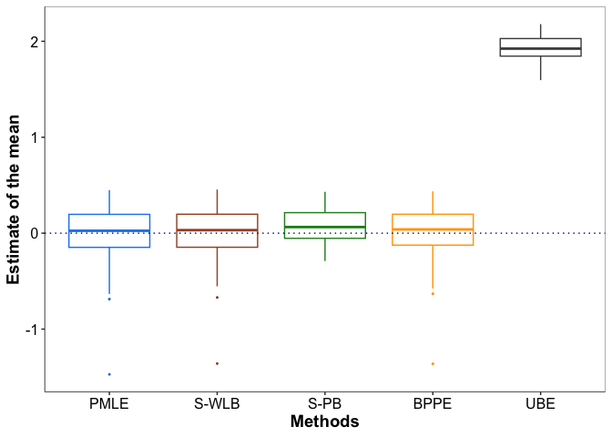
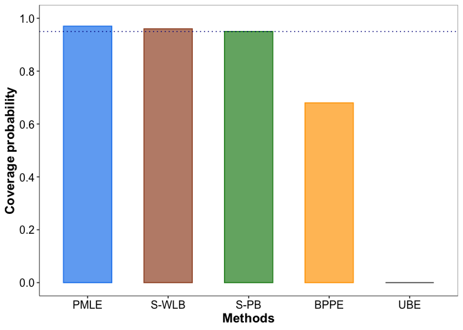
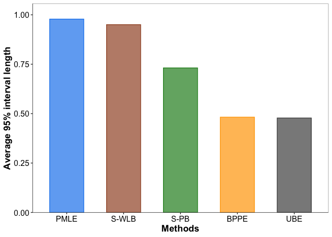

Model-based inference in complex surveys through targeted resampling of
weights
================

Implementation of modeling framework proposed in the paper [Das, S.,
Bandyopadhyay, D., and Pati, D. (2026+) Model-based inference in complex
surveys through targeted resampling of
weights](https://arxiv.org/abs/2504.11636).

## Overview

Survey data often arises from complex sampling designs with unequal
inclusion probabilities. When sampling is informative, traditional
inference methods can yield biased estimators and poor coverage. For
efficient inference on survey data, we propose the *Survey-adjusted
Weighted Likelihood Bootstrap* (S-WLB), which resamples weights from a
carefully chosen distribution centered around the underlying sampling
weights. S-WLB is theoretically consistent, and provides finite-sample
uncertainty intervals that are asymptotically valid. We further develop
the *Survey-adjusted Posterior Bootstrap* (S-PB), which extends S-WLB to
incorporate prior information, improving finite-sample estimation and
uncertainty quantification while retaining the asymptotic validity of
S-WLB. Both methods are computationally scalable and well suited for
inference under informative sampling.

## Functions

- **`func.R`** – Functions for generating survey data from a normal
  model, implementing the competing estimation methods, and conducting
  simulation studies.

  **Estimation methods:**

  - `oracle_iid_bayes` – Oracle Bayesian estimator based on an i.i.d.
    sample from the population.
  - `pmle_mean` – Pseudo Maximum Likelihood Estimator (PMLE).
  - `swlb_draws` – Our proposed Survey-adjusted Weighted Likelihood
    Bootstrap (S-WLB).
  - `spb_draws` – Our proposed Survey-adjusted Posterior Bootstrap
    (S-PB).
  - `bppe_draws` – Bayesian Pseudo Posterior Estimator (BPPE; [Savitsky
    & Toth,
    2016](https://projecteuclid.org/journals/electronic-journal-of-statistics/volume-10/issue-1/Bayesian-estimation-under-informative-sampling/10.1214/16-EJS1153.full)).
  - `wfpbb_draws` – Bayesian Weighted Estimator (BWE; [Gunawan et al.,
    2020](https://onlinelibrary.wiley.com/doi/abs/10.1111/anzs.12284)).
  - UBE – Unweighted Bayesian Estimator, implemented using `bppe_draws`
    with all sampling weights set to 1.

  **Additional functions:**

  - `data_normal` – Generates finite population data and survey samples
    under equal-probability or informative sampling.
  - `WFPBB` – Implements the weighted finite population Bayesian
    bootstrap resampling procedure used for BWE.
  - `pilot_prior` – Constructs an informative prior using data from an
    independent pilot survey.
  - `estimate_w0_pompe` – Estimates the prior calibration parameter for
    S-PB.
  - `ci_draws` – Computes uncertainty intervals from the simulated
    draws.
  - `wasserstein_1d_normal_emp` – Computes the empirical squared
    2-Wasserstein distance between two sets of draws.
  - `ise_to_oracle` and `ise_normal_to_oracle` – Compute discrepancies
    between estimated distributions and the oracle distribution.
  - `run_one_rep` – Runs a single simulation replicate and evaluates the
    competing methods.
  - `run_simulation_parallel` – Runs Monte Carlo simulation replicates
    in parallel.

## Example

We consider a finite population of size $N = 20,000$, where the outcome
$Y$ and the selection variable $X$ jointly follow a bivariate normal
distribution with means $\mu_y = \mu_x = 0$, standard deviations
$\sigma_y = 4$ and $\sigma_x = 3$, and correlation $\rho = 0.6$.

For each population unit $l = 1, 2, \ldots, N$, the inclusion
probability is given by $\pi_l = \Phi(\beta_0 + \beta_1 X_l)$, where
$\Phi$ denotes the standard normal cumulative distribution function,
$\beta_0 = -1.8$, and $\beta_1 = 0.15$. A survey sample is drawn using
independent Bernoulli selection indicators, resulting in an expected
sample size of approximately $n = 1000$.

The scaled sampling weights are defined as
$w_{n,i} = n\pi_i^{-1}/\sum_{j=1}^n\pi_j^{-1}$ for the sampled units.
Our objective is to estimate the superpopulation mean $\mu_y$ and
quantify the associated uncertainty.

For methods incorporating prior information, we specify a normal prior
$\mu_y \sim N(m_0,\tau^2)$ with $m_0 = 0.25$ and $\tau = 0.5$.

### Data generation

``` r
library(ggplot2)
source("func.R")

set.seed(200)

# Population parameters
n_target <- 1000
c_inv <- 20   # inverse sampling fraction
N <- c_inv * n_target

mu_x <- 0; mu_y <- 0
s_x <- 3; s_y <- 4
rho <- 0.6

# Sampling design
beta0 <- -1.8
beta1 <- 0.15

# Prior parameters
m0 <- 0.25
tau <- 0.5

# Bootstrap draws
B <- 2000

df <- data_normal(mu_x = mu_x, mu_y = mu_y, s_x = s_x, s_y = s_y,
  rho = rho, beta0 = beta0, beta1 = beta1, N = N)

# Realized survey sample size
df$n_samp
```

    ## [1] 1028

### S-WLB and S-PB estimation

We obtain point estimates and $95\%$ uncertainty intervals using our
proposed S-WLB and S-PB methods. For S-PB, the prior calibration
parameter is estimated using `estimate_w0_pompe`.

``` r
# S-WLB
swlb <- swlb_draws( y = df$y, w_tilde = df$w, B = B)

# S-PB
w0_hat <- estimate_w0_pompe(y = df$y, w_tilde = df$w, s_y = s_y)
spb <- spb_draws(y = df$y, w_tilde = df$w, s_y = s_y, m0 = m0, tau = tau, w0 = w0_hat, B = B)

# Point estimates and 95% intervals
data.frame(
  Method = c("S-WLB", "S-PB"),
  Estimate = c(mean(swlb), mean(spb)),
  Lower = c(ci_draws(swlb)[1], ci_draws(spb)[1]),
  Upper = c(ci_draws(swlb)[2], ci_draws(spb)[2])
)
```

    ##   Method   Estimate      Lower     Upper
    ## 1  S-WLB -0.3879270 -1.1942029 0.2293949
    ## 2   S-PB -0.1734987 -0.7224672 0.2221120

### Monte Carlo simulation

We perform $100$ Monte Carlo replicates to compare the performance of
PMLE, S-WLB, S-PB, BPPE, and UBE in terms of mean squared error,
coverage probability, and average interval length.

``` r
nRep <- 100

methods <- c("PMLE", "S-WLB", "S-PB", "BPPE", "UBE")

# Store point estimates, coverage indicators,
# and interval lengths
est <- CovI <- IntLen <- matrix(
  NA_real_, nrow = nRep, ncol = length(methods),
  dimnames = list(NULL, methods))

set.seed(200)

for (r in seq_len(nRep)) {

  # Generate survey data
  df <- data_normal(mu_x = mu_x, mu_y = mu_y, s_x = s_x, s_y = s_y,
    rho = rho, beta0 = beta0, beta1 = beta1, N = N)

  y <- df$y
  wt <- df$w
  n <- length(y)

  # PMLE
  pmle <- pmle_mean(y, wt)
  Iw_hat <- mean(wt^2 * ((y - pmle) / s_y^2)^2)
  pmle_var <- s_y^4 * Iw_hat / n
  ci_pmle <- pmle + qnorm(c(0.025, 0.975)) * sqrt(pmle_var)

  # S-WLB
  swlb <- swlb_draws(y, wt, B = B)
  ci_swlb <- ci_draws(swlb)

  # S-PB
  w0_hat <- estimate_w0_pompe(y, wt, s_y = s_y)
  spb <- spb_draws(y, wt, s_y = s_y, m0 = m0, tau = tau, w0 = w0_hat, B = B)
  ci_spb <- ci_draws(spb)

  # BPPE
  bppe <- bppe_draws(y, wt, s_y = s_y, m0 = m0, tau = tau, B = B)
  ci_bppe <- ci_draws(bppe)

  # UBE
  ube <- bppe_draws(y, rep(1, n), s_y = s_y, m0 = m0, tau = tau, B = B)
  ci_ube <- ci_draws(ube)

  # Store point estimates
  est[r, ] <- c(
    pmle, mean(swlb), mean(spb), mean(bppe), mean(ube)
  )

  # Store interval estimates
  intervals <- list( ci_pmle, ci_swlb, ci_spb, ci_bppe, ci_ube)

  # Coverage indicators
  CovI[r, ] <- sapply(intervals, function(ci) {as.integer(ci[1] <= mu_y && mu_y <= ci[2])})

  # Interval lengths
  IntLen[r, ] <- sapply(intervals, diff)
  
}
```

### Point estimation

The following boxplots compare the point estimates obtained from the
competing methods across $100$ Monte Carlo replicates. The dotted
horizontal line represents the true population mean $\mu_y$.

``` r
# all plots follow a pre-specified theme stored in "themegg", 
# which can be found in the README.Rmd file.

# Common colors and plot theme
method_colors <- c(
  "PMLE" = "dodgerblue2",
  "S-WLB" = "sienna",
  "S-PB" = "forestgreen",
  "BPPE" = "orange",
  "UBE" = "grey30"
)

# Data frame for point estimates
df.est <- data.frame(
  Method = factor(
    rep(methods, each = nRep),
    levels = methods
  ),
  Estimate = c(est))

# Boxplots
g.est <- ggplot(
  df.est,
  aes(x = Method, y = Estimate, color = Method)
) +
  geom_boxplot(
    outlier.size = 0.3
  ) +
  geom_hline(
    yintercept = mu_y,
    linetype = "dotted",
    color = "darkblue"
  ) +
  scale_color_manual(values = method_colors) +
  xlab("Methods") +
  ylab("Estimate of the mean") +
  themegg

g.est
```

<!-- -->

### Coverage probability

The following barplot displays the empirical coverage probabilities of
the $95$% intervals. The dotted horizontal line indicates the nominal
coverage level of $0.95$.

``` r
# all plots follow a pre-specified theme stored in "themegg", 
# which can be found in the README.Rmd file.

df.cov <- data.frame(
  Method = factor(methods, levels = methods),
  Coverage = colMeans(CovI)
)

g.cov <- ggplot(
  df.cov,
  aes(x = Method, y = Coverage, color = Method, fill = Method)
) +
  geom_col(
    width = 0.6,
    alpha = 0.7
  ) +
  geom_hline(
    yintercept = 0.95,
    linetype = "dotted",
    color = "darkblue"
  ) +
  scale_fill_manual(values = method_colors) +
  scale_color_manual(values = method_colors) +
  scale_y_continuous(
    limits = c(0, 1),
    breaks = seq(0, 1, 0.2)
  ) +
  xlab("Methods") +
  ylab("Coverage probability") +
  themegg

g.cov
```

<!-- -->

### Average interval length

The following barplot compares the average lengths of the $95$%
intervals across methods. Shorter intervals indicate more precise
inference, provided that the corresponding coverage probabilities remain
close to the nominal level.

``` r
# all plots follow a pre-specified theme stored in "themegg", 
# which can be found in the README.Rmd file.

df.len <- data.frame(
  Method = factor(methods, levels = methods),
  Avg_length = colMeans(IntLen)
)

g.len <- ggplot(
  df.len,
  aes(x = Method, y = Avg_length, color = Method, fill = Method)
) +
  geom_col(
    width = 0.6,
    alpha = 0.7
  ) +
  scale_color_manual(values = method_colors) +
  scale_fill_manual(values = method_colors) +
  scale_y_continuous(
    expand = expansion(mult = c(0, 0.08))
  ) +
  xlab("Methods") +
  ylab("Average 95% interval length") +
  themegg

g.len
```

<!-- -->
